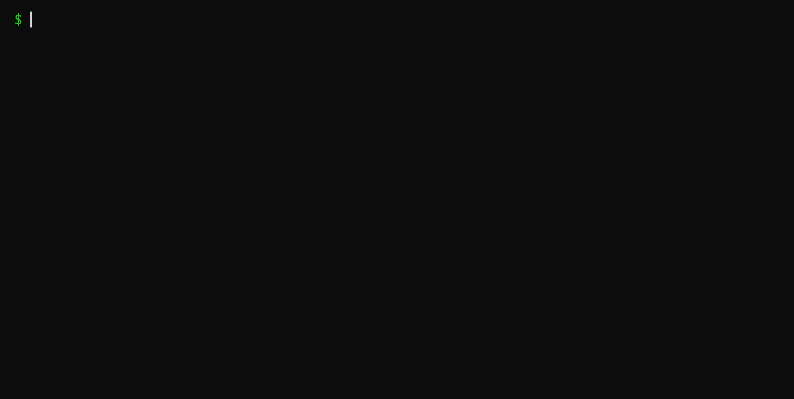
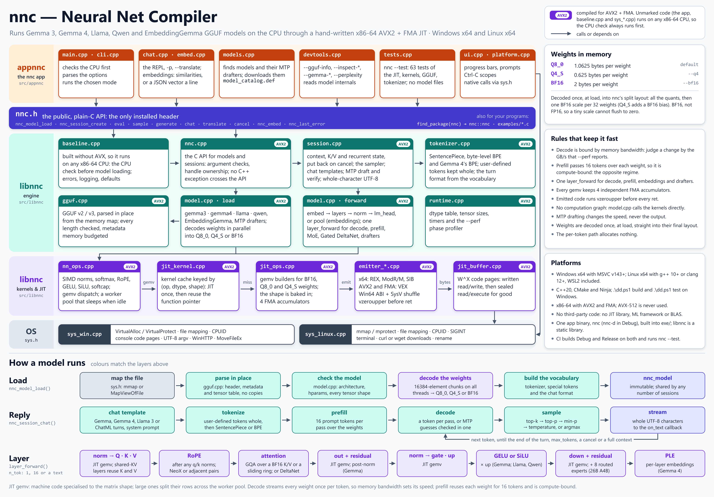

# nnc — Neural Net Compiler

[](https://github.com/ZacWalk/nnc/actions/workflows/linux.yml)
[](https://github.com/ZacWalk/nnc/actions/workflows/windows.yml)

I have always been fascinated by all the memory shuffling that happens to run a model on a GPU. What happens if you just run it on the CPU optimized for SIMD instructions. This is my learning project that JIT-compiles the hot operations of a transformer into machine code tuned for the host CPU, then uses it to run **Gemma inference end-to-end** on its own minimal tensor runtime.



No third-party JIT libraries and no ML frameworks — just a C++20 compiler and
hand-rolled x86-64 / AVX2 / FMA encoders. Runs on **Windows x64 and Linux x64**
(including WSL) from a single source tree: all OS-specific calls live behind a
small `sys.h` shim, and the JIT kernels are bit-identical on both platforms.



## What it does

- Loads a Gemma/llama GGUF by mmapping the file. F32/F16/BF16 weights are used in
  place; Q8_0 / Q4_K / Q5_K / Q6_K are decoded once at load time.
- **Q8_0 weight quantization by default**, decoded straight into an nnc-specific
  split layout with BF16 block metadata. `--q4` halves the bytes again at a real
  accuracy cost; `--bf16` keeps the source values.
- **Batched prefill** — one pass over the weights serves 16 prompt tokens rather
  than one, taking prefill from bandwidth-bound to compute-bound.
- Emits shape-specialized machine-code gemv kernels into executable pages and
  caches them by shape, so each is JITted once and reused.
- A static worker pool (default `min(8, CPUs)`, override with `NNC_THREADS`)
  parallelises every large gemv along the row axis.
- Softmax, layernorm, RMSNorm, RoPE, soft-cap, SwiGLU, GELU×up and elementwise
  ops all run as in-house AVX2/FMA kernels.
- An interactive chat REPL applies Gemma's turn template, greedy-decodes and
  streams detokenized UTF-8 to the console. `--perf` prints a per-phase timing
  breakdown after each reply.

Requires an x86-64 CPU with **AVX2 + FMA** — detected at startup, older CPUs are
refused. AVX-512 is intentionally not used.

## Getting a model

```powershell
.\dd.ps1 download --dry-run                      # list the known-good test models
.\dd.ps1 download --name gemma-3-1b-bf16 --yes   # ~1.9 GB, smallest end-to-end test
.\dd.ps1 download --name all --yes
```

Any `.gguf` under `./models`, `$HOME/.lmstudio/models` or `$HOME/models` is
offered by the interactive picker. `--inspect-model <file>` reports whether a
given file is loadable.

## Building

Requires CMake 3.21+ and Ninja, plus MSVC v143+ on Windows or g++ 10+ / clang++
12+ on Linux. The vendored [dd](https://github.com/ZacWalk/dd) runtime sets up
the compiler environment for you.

```powershell
.\dd.ps1 build        # both configurations
.\dd.ps1 test         # build and run the suite
.\dd.ps1 run          # build, then launch the REPL
```

Build trees live in `build/<HostSystem>-<preset>/`, so a Windows and a WSL build
of the same working tree do not fight over one cache. Binaries land in `exe/`.

The JIT kernels assume the Windows x64 calling convention; on Linux each kernel
prepends a small SysV→Win64 register shuffle so the same encoders are reused
unchanged.

## Running

With no `-m`, nnc scans the model directories and asks which to load. The app
loops on a `>` prompt; `/reset` clears the conversation and `/exit` quits.

Inspection modes include `--list-models`, `--gguf-info`, `--gguf-stats`,
`--inspect-model`, `--gemma-info`, `--gemma-probe`, `--gemma-forward`,
`--gemma-tokenize` and `--gemma-gen`.

## Documentation

- [docs/design.md](docs/design.md) — layering, the Q8_0 split layout, the JIT and
  its ABI, threading, the Gemma forward pass and where the headroom is
- [docs/models.md](docs/models.md) — models run end-to-end, with measured speed
  and resident memory, plus the ones that do not load and why
- [AGENTS.md](AGENTS.md) — conventions for contributors and coding agents

## License

[MIT](LICENSE)
